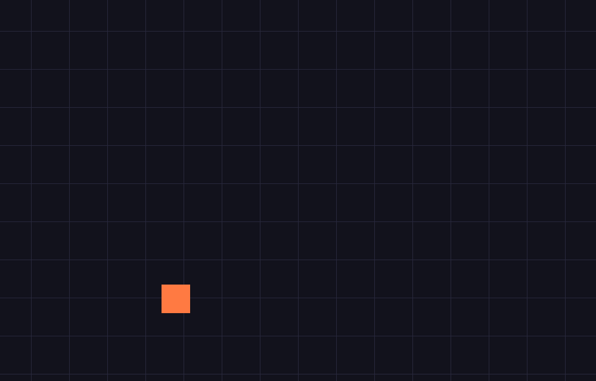

# Skippy

A cross-platform game built on **MonoGame**, with one shared game codebase and
three thin platform "heads":

| Target | Framework | Project | What it's for |
| --- | --- | --- | --- |
| 🖥️ **PC** (Windows / Linux / macOS) | MonoGame `DesktopGL` | `src/Skippy.Desktop` | The main development + release build |
| 🤖 **Android** | MonoGame `Android` | `src/Skippy.Android` | Native build to run on your phone |
| 🌐 **Browser** (HTML/WASM) | **KNI** `nkast.Xna.Framework.Blazor` | `src/Skippy.Web` | Zero-install preview from any device, incl. your phone |

All game logic lives once in **`src/Skippy.Core`** and is compiled into each
head. You write the game against the standard `Microsoft.Xna.Framework` API and
it runs everywhere.

The browser head is real, not aspirational — here is the shared game code
compiled to WebAssembly and running via KNI/WebGL (captured from a headless
browser loading the published build):



> **Why KNI for the browser?** Stock MonoGame has no stable browser target. KNI
> is an API-compatible MonoGame fork that keeps the exact same
> `Microsoft.Xna.Framework` namespace but adds a real Blazor WebAssembly + WebGL
> backend. So the browser preview genuinely runs "MonoGame under the hood" — the
> same `SkippyGame` class, unchanged. If official MonoGame ships a stable WASM
> target later, you can swap just the Web head.

---

## Prerequisites

- **.NET 8 SDK** — <https://dotnet.microsoft.com/download> (pinned in `global.json`)
- **Android workload** (only for the Android build): `dotnet workload install android`
- **MGCB content tools** (for assets): `dotnet tool restore`

## Build & run

```bash
# PC — build and play
dotnet run --project src/Skippy.Desktop

# Browser — local preview (open the printed localhost URL; reachable from your
# phone too if it's on the same Wi-Fi — see "Develop from your phone" below)
dotnet run --project src/Skippy.Web

# Android — deploy to a connected device / emulator
dotnet build src/Skippy.Android -t:Run -f net8.0-android

# Everything at once (compile check)
dotnet build Skippy.sln
```

The starter sample is a little square that chases your finger/mouse and bounces
off the walls, over an animated grid. It uses a runtime-generated texture, so it
runs on all three platforms immediately after cloning — no assets required.

## Develop from your phone

You have two complementary paths:

1. **Preview in the phone browser (no install).** The Web head is the preview
   surface. Either:
   - Run `dotnet run --project src/Skippy.Web` on your computer and open the
     `http://<your-computer-ip>:<port>` URL on your phone (same Wi-Fi), **or**
   - Let CI publish it: the `build` workflow publishes the Web build to **GitHub
     Pages** on pushes to `main`. Bookmark that URL and every push updates the
     preview you can open on your phone.
2. **Edit code from your phone.** Because the whole project builds in CI, you can
   edit on the go via the GitHub mobile web editor, **github.dev**, or **GitHub
   Codespaces**, push, and watch the Pages preview refresh — no PC needed to see
   your change.

For running the game *natively* on the phone, use the Android build.

## World engine

Skippy is an isometric, Age-of-Empires-II-style world: chunked and effectively
**infinite**, with stepped terrain **height**, **biomes** derived from temperature
and moisture (and **height cools temperature**, so mountains turn cold), and
**vegetation** that follows the climate.


It's built around a `World` base class that owns the whole map — its generator,
loaded chunks, camera, and its own update + render. The full design (chunk
streaming, the climate/biome model, the isometric renderer, and how to extend it)
is in **[docs/WORLD.md](docs/WORLD.md)**. Controls: arrows/WASD or drag to pan,
mouse wheel to zoom, TAB for the settings panel (time of day, map view, tile size,
zoom, grid), `,` / `.` to wind the clock, and M to cycle the map view directly.

## Claude Code on the web

`.claude/hooks/session-start.sh` (a SessionStart hook) installs the .NET 8 SDK
and warms the NuGet/MGCB caches automatically when a web session starts, so the
Desktop and Web heads build without manual setup. It installs the SDK via the
Ubuntu apt archive (reachable even when Microsoft's own download hosts are
blocked by an egress policy), falling back to Microsoft's installer script. The
Android head additionally needs `dotnet workload install android` (~1 GB), left
out of the hook by design. Once this is merged to your default branch, all
future web sessions pick it up.

## Content / assets

Textures, fonts, audio and shaders go through the MonoGame Content Pipeline. See
[`Content/README.md`](Content/README.md). The Desktop and Android heads build
content automatically; the Web head needs one copy step (documented there).

## Project layout

```
Skippy/
├─ Skippy.sln
├─ global.json                 # .NET SDK pin
├─ Directory.Build.props        # shared MSBuild settings
├─ Directory.Packages.props     # ALL NuGet versions (central management)
├─ .config/dotnet-tools.json    # MGCB content tools
├─ Content/                     # shared content pipeline (Content.mgcb)
├─ docs/ARCHITECTURE.md         # how the pieces fit together
├─ .github/workflows/build.yml  # CI: builds all 3 heads, deploys web preview
└─ src/
   ├─ Skippy.Core/              # 🎮 ALL game logic (shared, linked into heads)
   ├─ Skippy.Desktop/           # 🖥️ PC head
   ├─ Skippy.Android/           # 🤖 Android head
   └─ Skippy.Web/               # 🌐 Browser head (KNI/Blazor)
```

See [`docs/ARCHITECTURE.md`](docs/ARCHITECTURE.md) for the reasoning behind the
structure and how to extend it.

## A note on package versions

The versions in `Directory.Packages.props` are real, working starting points but
they age. Before your first build, bump them to the latest stable — especially
`nkast.Xna.Framework.Blazor` (KNI ships often). Central Package Management means
you only edit that one file.
