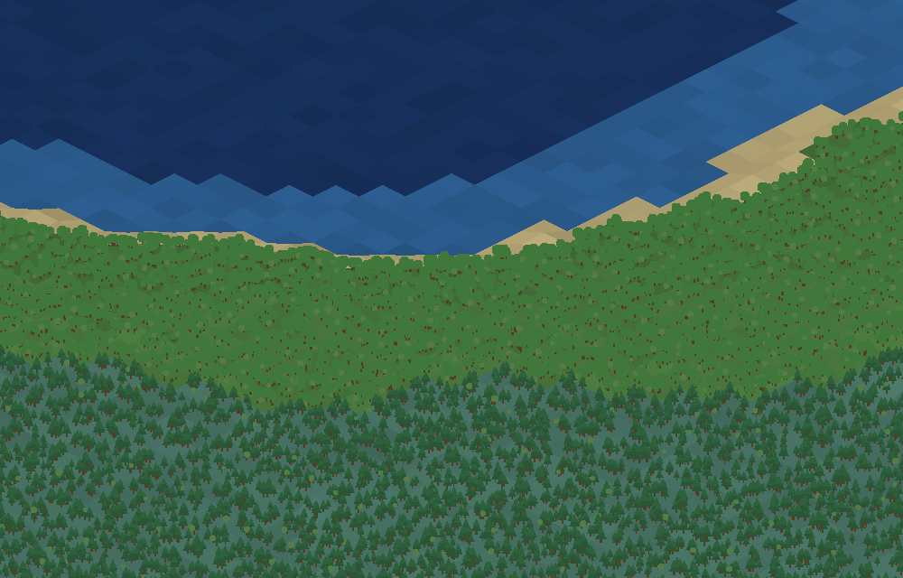

# World engine

An isometric, chunked, procedurally generated world — Age of Empires II in
silhouette: stepped terrain height, climate-driven biomes, and vegetation that
follows the climate. Everything lives in `src/Skippy.Core/Worlds/`.



*Coast → temperate broadleaf forest → taiga on the cooler high ground, the
terrain sloping smoothly between elevations. The pine belt appears where
elevation has cooled the land — height driving temperature driving biome.*

## The `World` base class

`World` is the base class the game builds on. **A world owns everything about the
map** and drives its own loop:

- `Update(gameTime, input)` — moves the camera (keyboard / drag / wheel) and
  streams chunks in and out around it.
- `Draw(spriteBatch, graphicsDevice)` — isometric render of the visible tiles.

Override the virtual seams to make a specific game world without touching the
streaming or rendering machinery:

| Seam | Purpose |
| --- | --- |
| `CreateGenerator(seed)` | Swap in a custom `IWorldGenerator`. |
| `OnChunkGenerated(chunk)` | React when a chunk first appears (spawn entities, etc.). |
| `Update` / `Draw` | Extend or replace the per-frame behavior. |

```csharp
public sealed class CampaignWorld : World
{
    public CampaignWorld(int seed) : base(seed) { }
    protected override IWorldGenerator CreateGenerator(int seed) => new MyGenerator(seed);
    protected override void OnChunkGenerated(Chunk chunk) { /* place resources */ }
}
```

## Streaming via chunks

The map is broken into fixed **32×32-tile chunks** (`Chunk.Size`). 32 is a
deliberate middle ground: big enough that per-chunk overhead is amortized over
1024 tiles, small enough that one chunk generates in well under a frame and culls
cleanly. Chunks are:

- stored in a `Dictionary<ChunkCoord, Chunk>`,
- generated on demand within `LoadRadius` chunks of the camera,
- discarded once outside it.

Nothing is ever stored for the map as a whole: generation is driven by
coordinate-based noise rather than by any fixed-size buffer, so it stays
deterministic (same seed + coordinate ⇒ same tile) however you wander into it.

A `Tile` is a value type (`Height`, `Level`, `Temperature`, `Moisture`, `Biome`,
`Vegetation`, `IsVoid`), so a chunk is one contiguous array with no per-tile
allocation.

## The world is a planet

The world is a **band that wraps east–west** and has **poles north and south**
(`WorldBounds`). Walk far enough east and you come back round to where you
started; walk north or south far enough and the ground runs out and there is
black beyond it.

The map is isometric, so the tile grid's own x and y both run diagonally on
screen — a rectangle in tile space would draw as a *diamond*, with its edges
heading off in two directions at once. So the world is not bounded in x and y. It
is bounded in the two axes you actually see:

| Axis | Meaning | Bounded? |
| --- | --- | --- |
| `v = x + y` | straight down the screen — north to south | yes: `Span` tiles pole to pole |
| `u = x − y` | straight across the screen — west to east | no: repeats every `2 × Span` |

So the horizontal extent is exactly **twice** the vertical one, and the map holds
`Span²` tiles. On screen it reads as a wide horizontal strip, the way a world map
does, rather than as a diagonal ribbon.

**There is no seam, because there is no join.** A lap east is the tile-space move
`(x, y) → (x + Span, y − Span)`, and *every* field the generator is built from is
periodic under exactly that move. So the coordinates simply keep counting up and
the same ground comes round again — no teleport, no stitching, no special case,
and no frame where two differently-generated halves have to be made to meet.
Everything downstream (coastal erosion, the spike cleanup, the lake flood) is a
pure function of position built on those fields, so it inherits the wrap for
free. `DefaultWorldGenerator` does it with two ideas:

- **Sample in the world's own frame.** Noise is evaluated at `(u, v)` rather than
  at `(x, y)`. The u/v axes are √2 longer per tile, so each field's frequency
  carries a `1/√2` factor to come out the size it was authored at.
- **Fit the lattice to the circumference.** Perlin noise is periodic if the
  integer lattice indices are folded into a period before lookup
  (`PerlinNoise.Sample(x, y, periodX)`), so every field's frequency is nudged to
  the nearest one fitting a **whole number** of noise cells around the world.
  At these frequencies that costs a fraction of a percent of the intended
  wavelength. Each fBm octave doubles the frequency and therefore the period,
  which stays whole — so a fractional lacunarity turns the wrap off rather than
  quietly leaving a seam.

The per-tile *hashes* cannot close on themselves that way, so anything using one
(where each tree stands within its tile) hashes `WorldBounds.Canonical` — the
position with its u folded back into the first lap — instead of the raw one.

**Past a pole** the generator still works the tile out in full but marks it
`IsVoid`: the last row of ground inside the world has to be shaped and lit
against genuine neighbours, not against a wall of nothing. It is simply never
drawn, nothing may walk onto it, and the cloud sheet is cut to the band (the
poles are lines of constant `v`, so in iso space they are two horizontal lines
and the crop is a clip on the overlay quad). The backdrop is cleared to **black**
rather than the sky colour, so what shows past a pole is nothing at all.
`StreamChunks` skips chunks lying more than one chunk beyond a pole, and the
camera's `v` is clamped to the band so it cannot be driven off the map and lost
in the black. `u` is never clamped — there is nothing to clamp it to.

## Climate model

The planet is banded by **latitude**, the way the real one is. `WorldBounds`
gives every tile a latitude from its `v` — 0 on the equator, 1 at either pole —
and the climate is built from a zonal profile at that latitude plus a *regional
anomaly* on top of it.

1. **Height** — fractal noise, reshaped for relief (broad oceans/lowlands, peaks
   that rise to bare rock), then quantized into discrete elevation steps.
2. **Temperature** — Earth's own annual zonal mean, pinned every 20° and
   normalized (`TempProfile`: 1.00 · 0.97 · 0.75 · 0.44 · 0.12 · 0.00), then
   **cooled by altitude** (a lapse rate):
   `temperature = zonal + anomaly − max(0, height − seaLevel) × lapse`.
   Flat across the tropics, where the sun is nearly overhead all year and 10°
   north of the equator is no cooler than the equator itself; a long, steady fall
   through the mid-latitudes; and **still falling at the pole**. That last part
   matters: a profile that flattens into the cap (a raised cosine, say) stops
   saying anything over the last stretch of the map, the anomaly takes over, and
   the world reads as *warming up again* as you reach the top of it.
3. **Moisture** — the circulation cells that put Earth's deserts where they are:
   air rises wet over the equator, comes down dry over the subtropics — the belt
   nearly every great desert on Earth sits in — rises again along the mid-latitude
   storm track, and the poles, being cold, are deserts too. So the map bands:
   rainforest on the equator, a ring of desert either side of it, then temperate
   forest, then tundra. Ground near the water table then reads damper, fading out
   with height rather than stepping at the shoreline.

The **anomaly** is what stops those bands reading as stripes painted across the
map: an independent fBm field, weighted well under half (0.42 / 0.40), so
latitude always wins — no amount of local warmth makes a pole temperate — while a
region can still run a good way warmer or wetter than its neighbours at the same
latitude. It is **damped over the cap** (`PolarCalm`), where the zonal profile is
shallower again, so nothing local can put a warm region nearer the pole than a
cold one. The pole is the coldest ground on the map wherever you stand on it,
which is what an ice cap is.

**The climate fields scale with the world.** They are sized as a fraction *of the
planet* (`TemperatureCells` / `MoistureCells` — so many noise cells all the way
round) rather than as a wavelength in tiles, so a tiny world gets the same handful
of warm and cool regions around it that a huge one does, instead of one climate
covering the lot. The terrain fields are the other way about: a mountain range is
the size a mountain range is whatever the planet's size, so those keep an absolute
scale and a big world simply has more of them.

Climate still changes **gradually, by construction** — hot must never border cold,
nor wet border dry. Only two octaves on the anomaly, since every extra octave adds
wiggle that reads as one tile being warmer than the one beside it, and the zonal
profile itself moves over a quarter of the planet.

The anomaly is **spread** through a logistic CDF before it is added. This matters
more than it sounds: fBm sums octaves, so its raw output is near-Gaussian and
bunched around 0.5 — measured over land it spanned barely 0.40–0.69. Regional
variation would have been all middling, never reaching the warm and dry ends that
make deserts, savanna and open grassland exist at all. `Spread` (sigma matched to
the field's measured deviation) stretches it evenly across 0..1.

The lapse rate is deliberately gentle (0.25). At 0.9 the altitude cooling was an
order of magnitude larger than the temperature field's own variation, so height
decided climate single-handedly and a third of all land clamped to freezing.
It is still what makes a peak colder than the country it stands in, and so what
puts snow on it.

### The world dials

`WorldSettings` holds four knobs for the world as a whole, all set from the
settings panel:

| Dial | Bands | What it moves |
| --- | --- | --- |
| **World size** | `TINY · SMALL · MEDIUM · LARGE · HUGE` | how big the planet is |
| **Temperature** | `ICY · COLD · TEMPERATE · WARM · HOT` | how warm the whole map runs |
| **Rainfall** | `ARID · DRY · MODERATE · WET · LUSH` | how wet the whole map runs |
| **Planet age** | `YOUNG · YOUTHFUL · MATURE · OLD · ANCIENT` | how hilly it is — how far erosion has got |

None of them adds a biome or a rule; each slides the whole map, so what changes is
the *kind* of world a given seed comes back as. Thin savanna over sand at
`HOT · ARID`; snow-laden taiga from coast to skyline at `ICY · LUSH`; cold high
tundra at `YOUNG` where `ANCIENT` gives rolling green lowland, off the same seed.

**Size** is the span from pole to pole — 256 · 512 · 1024 · 2048 · 4096 tiles, so
65k tiles at the bottom and 17M at the top, each band quadrupling the ground.
Powers of two and whole numbers, because the east–west wrap is the lattice move
`(x, y) → (x + Span, y − Span)` and has to land on the grid for the two sides to
meet. Every field's frequency is cut to fit the circumference, so changing size
re-fits them all (`DefaultWorldGenerator.Fit`) and the camera is put back on the
equator — a planet of a different size is a different planet, and the old position
means nothing on it.

**Temperature and rainfall slide the ends of their zonal profile** rather than
offsetting the finished field: a hot world gets a hotter equator *and* milder
poles, a cold one freezes the poles and cools the tropics. Offsetting the finished
field would have to clamp, and clamping flattens one end of the map to a single
value — a hot world where a third of the land reads exactly 1.0 and every
temperature difference within it has been squashed out. Moving the profile keeps
the whole spread of climates on the map. The profile ends deliberately sit outside
0..1 (a pole aiming below zero is what makes a genuine ice cap: ground at the
floor no matter which way the anomaly went).

Everything downstream follows for free, because it all reads the same fields:
biomes reclassify, vegetation follows the biome, and snow — which is weather, not a
biome — lies wherever the ground is now cold enough.

**Planet age weathers the height field**, before the mountains are laid on it. Land
height is taken as a fraction of the way from sea level to the cap and raised to a
power: above 1 it pulls the middle of that range down towards the sea — hills become
plains, mountains become hills, which is all erosion does to a map — and below 1 it
pushes ground that would have been a slope up into highland. A curve on the land
*fraction*, rather than a multiplier on the height, because it fixes both ends: sea
level maps to itself, so the coastline stays exactly where it was and only the relief
behind it changes, and the top of the range maps to itself, so nothing can push a
summit past the cap and quantize it into a flat plateau. The mountain uplift is
scaled by age on top of that, and because an old world's ground rarely climbs to the
mountain foot at all, it grows fewer ranges as well as lower ones.

That relief carries the climate with it: a young world's high ground is cold ground
(the lapse rate), so `YOUNG` reads as tundra and snow where `ANCIENT` is temperate
grassland — one dial, and the whole map answers.

The dials are baked into a tile when it is generated, so changing one calls
`World.Regenerate()`: the chunks are thrown away and rebuilt. That also drops the
**renderer's** cached meshes. They are keyed by chunk coordinate and a regenerated
world hands those same coordinates back, so without `WorldRenderer.Invalidate()`
the old ground goes on drawing over a map that no longer exists.

### Biomes = temperature × moisture

`BiomeClassifier` maps the resulting climate to a biome with a Whittaker-style
diagram. Height overrides handle the extremes (water below sea level, bare rock
above the rock line); everything else is a temperature × moisture grid:

```
            dry ───────────── moisture ───────────── wet
 cold │ Tundra          Taiga            Taiga
 temp │ Grassland       TemperateForest  Swamp
 warm │ Savanna         Grassland        Jungle
 hot  │ Desert          Savanna          Jungle
```

The grid is held as **data** (`TemperatureBands` / `MoistureBands` /
`ClimateBiomes`) rather than nested ifs, so `ClimateEdgeDistance` can measure how
far a tile sits from the nearest boundary. Open country is the default and forest
is the exception — trees are held to the wet end of each temperature band — which
lands roughly 33% of land in grass and 26% in trees.

Tune the thresholds in `BiomeClassifier`, and the sea/beach/rock lines in
`WorldConstants`.

**A lake is a size of water, not a kind of it.** Deep or shallow is a matter of how
far down the bed is, and one tile can answer that. Lake or sea is a matter of how
much water there is, and no tile can: a tile in the middle of a lake looks exactly
like a tile in the middle of an ocean. So `LakeFinder` measures the body instead —
it floods the water outward from the tile through the generator's own height field
and sees whether the whole thing closes inside `MaxLakeArea` (500 tiles). If it
does, every tile of it is `Biome.Lake`; if the flood runs past the cap, it is sea.
An inland sea is still a sea.

This is the one thing in generation that is not a pure function of a position, and
two properties keep it honest. It is **order-independent**: whichever of a body's
tiles is asked first, the body is the same size, so a lake is a lake whether you
arrive from the north or the south, and whether or not the rest of it is loaded.
And it is **paid once per body, not per tile**: every tile a flood touches is filed
with the body's verdict, and a flood that reaches a filed tile stops and takes its
answer — so the first tile of an ocean costs a 500-tile flood and the rest of that
ocean costs a dictionary lookup. Chunk generation measures ~40% slower over water
because of it. The cache is dropped when it grows past a cap (the map is endless,
the camera comes back) and on `World.Regenerate` through `IWorldGenerator.Reset`,
where the ground itself is about to change; losing it costs work, never
correctness.

Lakes wear the shallow-water tile rather than the deep blue, and no surf breaks on
them — `CollectShore` gates on `Tile.IsSea`, so a lake's edge is still water meeting
the bank. Everything else about water keys off `Tile.IsWater`, which counts them.

**Grass is coloured from climate, not from a swatch.** `BiomeRegistry.SurfaceColor`
gives grassland and savanna a colour along a single green-to-yellow ramp: water
drives it green, drought and heat bleach it back to yellow. It never leaves that
two-colour line, so big open country varies without going muddy.

**Tundra is pale year-round.** It wears the sheet's frost-dirt tile, washed towards
white as the atlas is packed (`TextureAtlas.GroundWash`), so frozen ground reads cold
from a distance well before it is cold enough for snow to lie on it. The wash is baked
into the pixels because a vertex colour can only darken a texture — making ground
*lighter* means changing the art.

**Snow is weather, not a biome.** There is no snow biome and no snow ground texture.
Snow lies wherever the ground is cold enough, whatever that ground is, drawn as a
white layer over it: first flakes at 6 °C, unbroken by −1 °C. It needs moisture to
fall at all (nothing settles on a cold desert) and breaks into drifts through a noise
threshold, so the edge of its range is patchy rather than a line. The snow line sits
above literal freezing because the temperature field is a yearly average: tundra
averages a few degrees above zero and is still under snow most of the year, and a line
pinned to 0 °C left the whole cold band nearly bare. The moisture floor is low for the
same reason — tundra is drier than most deserts, but nothing thaws there. So tundra,
taiga and cold high ground wear snow while the same ground in a warmer band does not,
and a snow-capped peak comes out of the lapse rate rather than out of the classifier.

**Plants are capped and rimed.** The snow on a plant is one white sprite sampling a mask
baked from the plant's own pixels (`TextureAtlas.SnowCap`), so it can only land where the
plant actually paints. The mask is mostly a *cap*: a pixel is snowy in proportion to how
little of the plant lies above it, which whitens the crown and the tops of the boughs and
leaves the undersides dark. Under that sits a floor — the *rime* that gets everywhere —
because a cap alone left tundra scrub as a dark blob with a white fringe: it is a dense
mass of twigs, so every pixel but the rim has something over it. A plant deep enough in
the snow gets the sprite twice, which covers what one coat's mask could not.

### Vegetation follows climate

Each tile carries a low-frequency **vegetation-density** field (its clumping
value). At render time this drives an **Age-of-Empires-II-style scatter**: a tile
places *many* individual plants (up to ~12) at randomized, deterministic
positions within its quad — dense broadleaf/pine forests, scattered savanna
trees, desert cactus, tundra shrubs — rather than one sprite per tile. Species
come from the biome; water and beaches stay clear. (`VegetationPicker` still
computes a single representative type per tile, handy for gameplay queries.)

Scatter counts are **rates per base-sized tile and may be fractional** — "a tree on
one tile in twenty" is a rate, not a number, and rounding it would lose it. The
remainder is settled with a coin toss, so a rate of 0.05 holds at any tile size.
That is what puts the odd lone tree out on open grassland, where the count used to
be a hard switch that left half the grassland bare and made a forest of the rest.

**Trees and bushes are painted art**, from `Assets/trees.png`. A `VegItem` carries a
seed, and the draw picks which of the sheet's variants that plant gets. Grass, cactus
and rocks are still drawn in code — the sheet carries no art for them — and jungles
borrow the broadleaves if it holds no palms.

### Forests have a species

The biome decides how many trees; it does not decide which. That is the **wood** the
tile stands in (`Forests`), because a real forest is not an even mix of everything
that will grow there: one species takes the light and the rest live under it, which
is why a pine wood a mile from an oak wood looks nothing like it.

A low-frequency **stand field** gives every wooded tile a `ForestKind` — `Conifer`,
`ConiferMixed`, `BroadleafMixed`, `Broadleaf`, `Palm`, `PalmMixed`. Each names its
primary tree and carries that tree's share of the canopy: a pure stand is ~88% its
own tree, a mixed one ~60/40. A pure stand keeps a tenth for the other kind rather
than none at all — a wood with literally one species in it reads as wallpaper, and
the odd stranger in the ranks is what makes the dominance look chosen. `AddTrees`
then splits the tile's whole tree budget between the two by share, so the proportion
holds however thickly the tile is planted.

The one climate coupling is that **cold favours evergreens**: temperature tilts the
stand field about a pivot in the middle of the temperate band. That puts evergreen
country where a player expects it without pinning it to the taiga — a temperate
forest is perfectly free to be a pine wood. Measured over a 512² map: taiga comes
out 82% evergreen stands, temperate forest splits 46% broadleaf / 31% evergreen /
23% mixed, savanna is broadleaf outright, and jungle is 65/35 palm.

A wood is not only one *kind* of tree but, mostly, one **tree**. A second field (its
own seed, so its patches cut across the kind's rather than lining up with them) picks
one form out of that kind's art, and `Form` draws it `StandPurity` of the time. So a
stand reads as one recognisable tree with a few others scattered through it, and
every painted tree still gets used somewhere instead of the sheet's first few taking
every pure stand on the map. Standing deadwood is bare either way, and is rolled at
random.

Stands run ~28 tiles across on average and their species patches ~19, so you walk
through one wood for a while before it changes. Both are tuned by `StandScale` /
`SpeciesScale`. Mouse over a tile to read its wood in the HUD.

**One sheet carries every plant.** The bushes used to come off a second sheet of their
own; they now come off the lower rows of the tree sheet like everything else, so there
is one file to repaint and one row convention to remember.

**Some plants come up dead**, and the sheet has its own bare-wood art for that.
Each `Add` call takes the share that should be deadwood: a few percent in healthy
woods, more in swamp and savanna where trees drown or bake, and **always** on
tundra, where nothing holds a leaf.

### Getting the art out of the sheets

`TextureAtlas` builds one texture at runtime out of the procedural shapes *and* the
sheets, so the world still draws with a single texture bound. The sheets are
embedded in the assembly rather than read off disk, so every head loads them the
same way and the browser build needs no file server.

Three parts of this are worth knowing, because the obvious approach fails at each:

- **Keying.** The sheets arrive with a backdrop rather than transparency. Thresholding
  on distance from one backdrop colour cannot work: measured off the art, the card
  sits at luminance ~18 with almost no colour in it, while *shaded foliage is darker
  than the card* and is only distinguishable by being coloured at all. Any threshold
  loose enough to keep that foliage also keeps the soft glow the sheets carry around
  each subject, leaving every plant on a visible rectangle of card; any threshold
  tight enough to remove the glow eats the foliage. So the backdrop is **flooded**
  from the sheet's edges instead — only backdrop that connects to the outside is
  removed, and shade enclosed by a plant survives however dark it is. Its shades are
  read off the sheet's border rather than assumed, because a sheet exported flattened
  out of an image editor carries the editor's transparency **checkerboard** — two
  greys about 15 apart, which no single backdrop colour covers.
- **Cutting.** The sprites are found by looking for the empty gaps between them, not
  by assuming a grid; the rows are not evenly spaced and a fixed grid slices the tall
  trees in half. Each sprite's own top and bottom are then found within its row, so a
  knee-high shrub painted beside a tree is its own height and not the row's.
- **Sorting.** The rows carry the meaning — bare wood, broadleaves, conifers, then
  bushes for the rest — but a row can hold more than one kind, and those are split by
  the shape of the art rather than by counting columns, so the sheet can be repainted
  with more (or fewer) of anything without the code changing. A squat piece among the
  bare wood is a leafless bush; a piece carrying its width up at the top, over a bare
  trunk, is a palm rather than a conifer.

Each kind is resampled to the height that kind is stored at — trees to one, bushes to
another — so a plant's size on screen follows from what it is rather than from how big
it happened to be drawn on the sheet. The atlas carries mip levels, sampled
`LinearClamp` with a transparent gutter around each sprite. Point-sampling art that
draws several times smaller than it is stored makes foliage crawl.

**Trees thin out towards a biome's edge.** Canopy counts are scaled by
`ClimateEdgeDistance`, so a wood frays into the open ground beside it instead of
stopping on a hard line. Only trees fade — undergrowth stays put, and the fade
floors just above zero so two neighbouring woods don't leave a bald seam.

## Isometric rendering

`WorldRenderer` draws the visible tiles in painter's order along screen diagonals.

Terrain is **smooth, Age-of-Empires-II-style**: elevation lives at tile *corners*,
so each tile is a four-corner quad that ramps between its neighbors instead of
stepping with vertical cliffs. Shared corners use the same level, so the surface
stays seamless. Tiles are drawn as colored triangles (two per tile) through a
`BasicEffect`.

**The coastline is the waterline, not the tile grid.** A water tile that paints its
whole diamond makes the coast a sawtooth of diamond edges — invisible at 64 pixels,
a staircase of 250-pixel teeth at 312. So a shore tile — one with water on one side
of it and dry land on the other, *whichever of the two it is itself* — draws in two
layers: the water sheet across the whole tile, then the ground over it, cut back at
the waterline. Both sides of a coast draw the same two layers and cut against the
same field, so the line runs across tiles instead of around them.

The line itself comes from a **wetness field**: 0 on a water tile, 1 on land,
blurred once and sampled smoothly, then read through a position warp (the same trick
the biome borders use) so it wanders off the grid it was built from rather than
tracing it. It is combined with how far the ground stands above the local water
surface, which is what keeps the edge crisp on a steep bank and lets the wet field
decide on a flat one; ground well clear of the surface is dry whatever the field
says, so a bank cannot flood.

**The cut is geometric.** Fading the ground out cannot make an edge narrower than
the cell it is interpolated across, and where a bank plunges into the water one cell
covers a long stretch of screen — the coast came out as a smear of half-transparent
ground trailing into the water. Each cell is clipped along the waterline instead.
Subdividing shore tiles more finely was the other option and it does not work: an
edge shared with a coarser tile cracks (the T-junction seams removed in #24).

The water sheet lies level with the water beside it, taken from the water tiles at
each corner rather than from the terrain, and climbs behind the bank where the
ground is higher so a cut never exposes the sky. **Every** water tile draws that
same sheet: mixing subdivided sheets near the coast with flat quads further out
leaves slivers of background wherever the two rules disagree along a shared edge.

**Biome edges blend, with no hard tile borders.** Each corner is colored by
averaging the biomes of the (up to four) tiles meeting there, and those colors
are assigned per-vertex so the GPU interpolates a smooth gradient across the
quad — grass fades into sand, and the shoreline softens from deep water through
shallows to wet sand. Per-tile elevation and slope-lighting shading is folded in
before the blend. Vegetation is then stamped on top with a `SpriteBatch`, using
runtime-generated art (a disc, a triangle, a pixel) — no content-pipeline assets.

`Iso` holds the 2:1 projection (`TileToIso` / `IsoToTile`); `Camera` tracks a
focus point in world-tile space plus zoom, so it stays put as chunks stream.

**Tile size is one knob, live-adjustable.** `Iso.TileWidth` is the only authored
value; the diamond height (tiles are 2:1) and the elevation `HeightStep` follow
from it. Hold `[` / `]` in game to step it by 8 px between 16 and 512 — the
current value is in the top-right read-out, so a size can be picked by eye and
then written back as the `Iso` default.

**A tile is an amount of ground, not a zoom level.** What stands on a tile keeps
its own absolute size however big the tile is, so a wider tile is simply more room
and fits more on it. Scatter counts are authored per `Iso.BaseTileWidth` tile and
multiplied by `Iso.TileAreaScale`, which keeps plants-per-acre constant as tiles
resize; `MaxPlantsPerTile` caps that so a very large tile can't put six figures of
sprites into one chunk mesh. To make everything bigger on screen, zoom the camera
instead.

**The ground texture obeys that too — it repeats rather than stretches.** Painted
for a `BaseTileWidth` tile, one repeat stretched across a 312-pixel tile blew a
painted stone up bigger than a tree. It now repeats about once per `BaseTileWidth`
of ground (`GroundRepeatPixels`), so the detail stays the size it was drawn at
whatever the tiles are set to. The repeat count is snapped to a divisor of `Subdiv`
so no sub-cell straddles a join, and each repeat is flipped by its own position hash
so a tile doesn't read as one square stamped six times. Texture coordinates are
therefore held **per sub-cell** rather than per sub-vertex (`_cellUv`): they jump
back to the start of the texture at every repeat, so the cells either side of a join
disagree about the vertex between them — which costs nothing, since the mesh builder
writes its own vertices per triangle anyway.

Chunk meshes are baked in iso pixels, so every resize invalidates them:
`Iso.Version` bumps, and `WorldRenderer` throws away all cached meshes and
rebuilds the visible ones. That is why the key-repeat is deliberately unhurried.
Note that `LoadRadius` counts chunks, not screen distance, so at very small tile
sizes the edge of the loaded window can come into view.

**Hover read-out.** `World.TryGetTileAtScreen` turns a screen point back into a
tile, and the HUD shows that tile's height, temperature (in °C) and moisture. The
inverse projection ignores elevation, so over steep ground the pick lands slightly
downhill of what is drawn under the cursor.

**Map views** (`World.MapView`, M) swap the terrain's colouring from biomes to one
of the generator's raw input fields — height, temperature (after the altitude
lapse) or moisture — so you can see *why* a biome landed where it did. The data
views are drawn unshaded and without vegetation: elevation and slope lighting
would make a value impossible to read off the screen, and plants would hide the
ground. Terrain meshes bake their vertex colours, so switching view rebuilds them
exactly as a tile resize does.

**Tile grid** (`World.ShowTileGrid`, G) draws a line along every tile edge, using
the same corner elevations as the terrain so it drapes over hills. It is a
per-chunk mesh cached exactly like the terrain, built only while the grid is on.

**Shadows follow the sun, without rebuilding anything.** A plant's shadow is not one
disc but a short row of four soft ones, all baked at the plant's own foot, each carrying
in the vertex's otherwise unused z how far along the shadow it belongs — nothing else in
the mesh uses z, everything is drawn flat. The renderer then puts a shear in the view
matrix that turns that z into an offset across the ground away from the sun. The near
disc barely moves, so the pool stays under the plant that cast it; the rest fan out
further and further as the sun drops (1/tan of its altitude, clamped — at a few degrees
the real figure runs to ten times the caster's height and the row pulls apart into a
dotted line), which is what draws the shadow out into a long tapering smear. A row of
pieces is the only way this can stretch at all: the shear can translate a quad, not
scale one. Vertices at z = 0 pass through untouched, so one matrix moves every shadow on
the map and nothing else, and a full day passes without a vertex being re-uploaded — the
same trick the directional light already plays.

Each chunk is therefore **three meshes**, not one — its ground, its shadows and its
plants — drawn in that order across every visible chunk. Keeping the shadows to
themselves is what lets the shear and the day's shadow strength apply to them alone:
the strength is `SkyLight.Sunlight`, which is zero while the sun is below the horizon,
so at night the layer is skipped entirely and there are no shadows without a sun.

The shear rides in the **view** matrix, not the world matrix. It is singular by design
(it flattens z), and `BasicEffect` derives the matrix it lights normals with by
inverting the world matrix: given a flattened one, every normal comes out garbage and
the whole map draws black.

### Depth-tested foliage and mobs (prototype, B)

By default the plants and the mobs resolve against each other by **painter's order**: a
per-frame foot-Y sort, and a slice interleave that breaks each chunk's veg mesh wherever a
mob is standing so the mob is covered by the trees in front of it and covers the ones
behind. That order is correct for one thing at a time standing on flat-enough ground, but
it can express nothing about a plant or a mob standing **behind a hill** — the plants and
mobs are drawn as a layer *over* the whole terrain, so a hill between them and the camera
never hides them.

Pressing **B** (`World.DepthBuffer`) switches on a **GPU depth buffer** for that layer
instead. It rests on one depth key shared by the ground and the billboards:

```
depth = 0.5 − (isoY − focusY) · zoom / (viewportHeight · DepthMargin)
```

The **ground** reads it per fragment from the screen-Y it lands at (so within the ground
nothing is resolved by depth — every fragment at a given pixel shares a screen-Y, and the
layering of water, biome blends, snow and surf is still decided by draw order). Each
**billboard** reads it *once from its foot*, baked into the vertex z (`MeshBuilder.DepthZ`
for plants and grass, a `depthZ` argument for mobs) — so a whole plant or mob resolves at
the ground it stands on, not by its own height on screen (a tall crown must not read as
"further back" than its base). The two forms are the same formula, so terrain in front of
a plant hides it and terrain behind does not — the case the sort cannot draw — and plants
and mobs resolve against each other and the terrain per pixel, which lets the whole veg
mesh and every mob be drawn straight through with **no sort and no slice interleave**.

Two matrices carry the key. The ground uses a projection that reads depth from the
post-view screen-Y; the foliage/mob pass uses a projection that reads it from the baked z,
with the camera focus folded out of z in the view first, so the subtraction never runs as
(huge − huge) far from the origin and the depth keeps its precision. A billboard z is
otherwise the shadow lean (above), but shadows and bodies are never the same quad, and the
depth pass draws only bodies.

The one real cost: depth-writing and the smooth alpha blend do not mix — a translucent leaf
edge would stamp an invisible occluder — so the depth pass **alpha-tests** through a stock
`AlphaTestEffect` (a texel is kept whole or dropped) rather than blending. Foliage edges
come out harder than the painter path's, and anything carried below the alpha threshold (a
faint snow cap, the soft selection ring) thins out. `AlphaTestEffect` does no lighting, so
the day's tint on an up-facing billboard is folded into its `DiffuseColor` each frame. The
depth path is a prototype and off by default; the painter path is unchanged.

## Mobs

Everything that walks lives in `Worlds/Mobs/`. `Mob` is the base class: a point in
**fractional world-tile space** with a speed, a facing and a walk cycle. It is not a
tile occupant — it walks in a straight line and the grid only comes up as a question
of what it may step onto — so movement stays smooth however big the tiles are drawn.
Subclasses supply how fast they walk and what they want:

```csharp
public sealed class Sheep : Mob
{
    public override MobKind Kind => MobKind.Sheep;
    protected override float WalkSpeed => 0.55f;      // tiles per second
    protected override void Think(World world, float dt) { /* wander */ }
}
```

`WalkToward` does the walking and reports back `Moving`, `Arrived` or `Blocked`. It
refuses to step into water, off the loaded map, or up more than a few elevation
levels, and if the direct line is refused it tries a slant either side of it before
giving up — enough to follow a shoreline round rather than stopping dead against it.
A `Blocked` mob's brain simply picks somewhere else to be.

**Sheep wander in a graze-walk-graze cycle.** Each picks a spot within a few tiles of
**where it was put down** — not of where it currently is, which is a random walk and
drifts off over the horizon given long enough — ambles to it, then grazes for a few
seconds before choosing again. Every sheep rolls its rests out of its own seeded RNG,
so a flock never sets off as one block.

### Vitals

Every mob carries a `Vitals` — its body, as opposed to its brain. `Mob` only decides
what to do; everything that *happens* to it happens here:

| | |
| --- | --- |
| `Health` / `MaxHealth` | what it has left, and full |
| `Hunger` | 0 fed → 1 starving |
| `Tiredness` | 0 fresh → 1 dead on its feet |
| `Gender` | rolled from the mob's seed |
| `AgeDays` | plus `Stage` — young, adult, old |
| `Ailments` | `Starving · Exhausted · Injured · Sick · Frail`, as flags — they stack |

**Bodies keep time in world days, not seconds.** A mob ages one day per turn of the
sun whatever `DayLength` is set to, so a sheep lives at the same pace against the sky
whether a day takes four minutes or ten. Every rate is written as a "days to" —
`DaysToStarve`, `DaysToRest`, `DaysToHeal` — because "how long an animal that never
eats takes to go from full to starving" is a number you can argue with, and a rate per
second is not. A species sets the ones it disagrees with and leaves the rest.

What a mob is doing decides what its body is charged: `MobActivity` — idle, moving,
resting, feeding. Walking tires it at the full rate, standing about at a fraction of
it, and grazing pays back both hunger and tiredness, which is why a sheep left alone
never starves: a stopped sheep is a feeding sheep.

The wasting ailments are **read off the body every frame** rather than remembered, so
they clear the moment the animal is fed or rested — with a gap between the level that
raises one and the level that drops it, or a mob sitting exactly on the line would
flicker in and out of it. `Injured` follows the wounds it has taken (below half
health); `Sick` is the one nothing here raises, left for whatever gives an animal a
disease. Ailments then draw on health — starvation hardest, exhaustion and old age
more slowly, all of them stacking — and a body with none of them heals instead. At
zero health the mob dies and the world clears it away that same frame.

Age is visible: `Scale` is the mob's own size jitter times `Growth`, so a lamb is a
small sheep rather than a different sprite, and a flock turns up as assorted ages with
the odd young one among them.

**Click a mob to read it.** `WorldRenderer.PickMob` turns a screen point into the mob
under it, frontmost first, off the positions worked out for the last frame drawn — the
one the person clicking was looking at. The hit box is never allowed below
`MinPickSize` on screen, because a sheep is a dozen pixels tall at most and a lamb far
less; asking anyone to hit that exactly is asking them to miss. The selected mob stands
in a pale pool of light, and its vitals go up on the read-out beneath the tile lines.
Clicking bare ground clears it.

The world owns its mobs rather than the chunks doing so: a mob walks, so the chunk
under it changes, and one unloaded with the ground it happened to be over would blink
out of existence. A small flock is put down at the spawn point on the first frame that
finds dry land there — `SpawnStarterFlock`, which searches outward in rings from the
camera and simply tries again next frame if there is nothing but sea.

Rendering them takes a different path from everything else on the map. Terrain and
plants are baked once into a chunk's GPU buffers and drawn for as long as the chunk
lives; a mob is somewhere else next frame, so `SpriteLayer` keeps its quads in plain
CPU arrays (reused between frames) and hands them straight to the device. Their
shadows join the plants' shadow layer and so swing round with the same sun.

**A mob is drawn among the plants, not over them.** Each chunk's vegetation mesh
records where every plant's geometry begins and the screen y it was sorted at
(`ChunkMesh.Slice`), so the mesh can be drawn in slices: the plants down to a mob's
feet, then the mob, then the rest. Both sides are already in y order, so it is a merge
of two sorted lists, and a chunk with no mobs on it still draws in a single call. The
alternative — one draw for the whole layer — is what made a sheep walk over the front
of a tree it was standing behind.

The obvious fix, a depth buffer, is not open to us: these are alpha-blended billboards,
and a nearer one would write depth from its transparent corners and punch rectangles
out of everything behind it. Depth needs alpha *testing*, which would mean giving up
`BasicEffect` and with it the sun on the foliage.

Their feet sit on `SurfaceLevel`, which is the same Catmull-Rom of the level field the
terrain mesh is built from, only read straight out of the world instead of out of one
chunk's cached copy. Sampling the same curve is what puts a mob on the surface the
ground was actually drawn at rather than on the flat top of its tile.

The art is **painted in code**, like the grass and the rocks: a sheep is a cluster of
overlapping circles for the fleece — one ellipse comes out as a bean, several make it
lumpy the way wool is — over a dark head and four short legs, supersampled for its
edges and packed into the same atlas as everything else. It is painted facing right,
and mirrored by flipping its UVs when a mob walks the other way.

## Controls

| Input | Action |
| --- | --- |
| TAB | Open / close the settings panel |
| Arrow keys / WASD | Pan the camera — or, with the panel open, walk it |
| Mouse drag / touch drag | Pan the camera |
| Mouse wheel | Zoom in / out (0.4× to 16×) |
| Mouse over a tile | Read its coordinates, latitude, biome and climate in the HUD |
| Click a mob | Select it — its vitals go up on the HUD; click bare ground to clear |
| G | Toggle the tile-grid overlay |
| B | Toggle the depth-tested foliage/mob path (prototype — see below) |
| `[` / `]` | Shrink / grow the tiles (hold to repeat) |
| `,` / `.` | Wind the time of day back / forward (holds the clock) |
| P | Hold the clock where it is, or let the day run again |
| M | Cycle the map view: biome → height → temp → moisture |
| F11 | Toggle fullscreen (desktop) |
| ESC | Close the panel, or quit |

### The settings panel

`SettingsMenu` gathers the world's knobs — the time of day, the clock, the day length,
the world dials (size, climate and age), the map view, the tile size, the zoom, the grid —
somewhere they can be found, instead of each one living on a key you have to know about. TAB opens it; UP/DOWN walk it,
LEFT/RIGHT change the selected setting (held, for the ones with a long range), ENTER
acts on it, and rows can be clicked.

Each setting is one row: a label, something that reads the current value back as text,
and a step that changes it. The panel knows nothing about what any of them mean, so
adding a setting is adding a row.

**A day is four minutes** (`SkyLight.DayLength`, 240 s), which the panel steps between
20 s and 10 minutes. Long enough that the light on the ground is something you notice
changing rather than watch race, short enough that a session sees several dawns.

While it is open the world is handed an input state that is never updated, so it reads
as untouched: the panel and the camera share the arrow keys, and this is what stops one
press doing both. The world itself keeps running behind it — the sun crosses the sky,
chunks stream — it just stops listening.

## Where to go next

- **Rivers / lakes** — add a hydrology pass in the generator (flow from height).
- **Resources & entities** — spawn in `OnChunkGenerated`; store per-chunk.
- **Save / load** — chunks are plain data keyed by `ChunkCoord`; serialize the
  dictionary or regenerate from seed.
- **Real art** — replace the runtime shapes in `WorldRenderer` with sprites from
  the content pipeline (see `Content/README.md`); the projection is unchanged.
